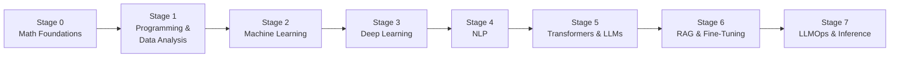

# Machine Learning & AI Engineer Roadmap

### Hello AI Engineers of the future! 👋

This roadmap takes you from the math foundations all the way to building, fine-tuning and serving Large Language Models in production. It is split into **8 stages**. Each stage has:

- 🎯 **Goal**: what you should be able to do when you finish
- 📚 **Topics**: a checklist of what to learn
- 🔗 **Resources**: courses, books, videos and docs
- 🛠️ **Projects**: things to build to prove you learned it
- ✅ **Milestone**: how to know you're ready for the next stage

---

## 🗺️ Roadmap at a Glance

| Stage | Topic | Suggested Time |
|:-----:|-------|:--------------:|
| 0 | [Math Foundations](#stage-0--math-foundations) | 4–6 weeks |
| 1 | [Programming & Data Analysis](#stage-1--programming--data-analysis) | 6–8 weeks |
| 2 | [Machine Learning](#stage-2--machine-learning) | 8–10 weeks |
| 3 | [Deep Learning](#stage-3--deep-learning) | 8–10 weeks |
| 4 | [NLP](#stage-4--natural-language-processing-nlp) | 4–6 weeks |
| 5 | [Transformers & LLMs](#stage-5--transformers--large-language-models) | 6–8 weeks |
| 6 | [RAG & Fine-Tuning](#stage-6--rag--fine-tuning) | 6–8 weeks |
| 7 | [LLMOps & Inference](#stage-7--llmops--inference) | 6–8 weeks |

> ⏱️ Times assume ~10–15 hours/week. Go at your own pace: understanding beats speed.

---

## Stage 0 — Math Foundations

🎯 **Goal:** Understand the math that ML models are built on, enough to read formulas without fear.

### 📚 Topics
- [ ] **Linear Algebra:** vectors, matrices, matrix multiplication, dot product, eigenvalues/eigenvectors, SVD
- [ ] **Calculus:** derivatives, partial derivatives, chain rule, gradients
- [ ] **Probability & Statistics:** distributions, mean/variance, Bayes' theorem, hypothesis testing, correlation

### 🔗 Resources

#### Linear Algebra
- [freecodecamp](https://www.youtube.com/watch?v=rSjt1E9WHaQ)
- [Coursera: Mathematics for Machine Learning Specialization](https://www.coursera.org/specializations/mathematics-machine-learning#courses)
- [3Blue1Brown: Essence of Linear Algebra](https://www.youtube.com/playlist?list=PLZHQObOWTQDPD3MizzM2xVFitgF8hE_ab)

#### Calculus
- [Coursera: Differential Calculus](https://www.coursera.org/learn/algebra-and-differential-calculus-for-data-science#syllabus)
- [3Blue1Brown: Essence of Calculus](https://www.youtube.com/playlist?list=PLZHQObOWTQDMsr9K-rj53DwVRMYO3t5Yr)

#### Statistics
- [Coursera: Stanford Statistics](https://www.coursera.org/learn/stanford-statistics#syllabus)
- [freecodecamp](https://www.youtube.com/watch?v=xxpc-HPKN28)
- [Khan Academy: Statistics & Probability](https://www.khanacademy.org/math/statistics-probability)
- [StatQuest with Josh Starmer](https://www.youtube.com/@statquest)

#### Book (optional, free)
- [Mathematics for Machine Learning](https://mml-book.github.io/)

### ✅ Milestone
You can explain what a gradient is, multiply two matrices by hand, and explain the difference between mean, median and standard deviation.

---

## Stage 1 — Programming & Data Analysis

🎯 **Goal:** Write clean Python, manipulate data, and tell a story with it.

### 📚 Topics
- [ ] **Python:** data types, control flow, functions, OOP, list comprehensions, virtual environments
- [ ] **NumPy:** arrays, broadcasting, vectorized operations
- [ ] **Pandas:** DataFrames, cleaning, grouping, merging, handling missing values
- [ ] **Visualization:** Matplotlib, Seaborn
- [ ] **SQL:** SELECT, JOIN, GROUP BY, window functions
- [ ] **Git & GitHub:** commits, branches, pull requests
- [ ] **Exploratory Data Analysis (EDA)**

### 🔗 Resources

#### Python
- [Elzero Web School](https://youtube.com/playlist?list=PLDoPjvoNmBAyE_gei5d18qkfIe-Z8mocs&si=ypysHAllTf8WkKZ2)
- [Codezilla](https://youtube.com/playlist?list=PLuXY3ddo_8nzrO74UeZQVZOb5-wIS6krJ&si=csrng5PEFs89F9hj)
- [Official Python Tutorial](https://docs.python.org/3/tutorial/)

#### NumPy
- [freecodecamp](https://youtu.be/QUT1VHiLmmI?si=-WZKQYoQoddMxYeM)
- [Elzero Web School](https://youtube.com/playlist?list=PLUgz8T_NoatsJCH-DmieQhqhSL2WBvlm-&si=zs-ZTKyPYlY417LW)

#### Pandas
- [Alex The Analyst](https://www.youtube.com/watch?v=dUpyC40cF6Q&list=PLUaB-1hjhk8GZOuylZqLz-Qt9RIdZZMBE)
- [W3Schools](https://www.w3schools.com/python/pandas/default.asp)
- [Pandas Documentation](https://pandas.pydata.org/docs/user_guide/index.html#user-guide)

#### Visualization
- [freecodecamp: Matplotlib](https://youtu.be/3Xc3CA655Y4?si=oj4JLhH3HkYX9iiz)
- [Matplotlib Documentation](https://matplotlib.org/stable/users/index.html)
- [Seaborn Tutorial](https://seaborn.pydata.org/tutorial.html)

#### SQL & Git
- [Kaggle: Intro to SQL](https://www.kaggle.com/learn/intro-to-sql)
- [SQLBolt (interactive)](https://sqlbolt.com/)
- [Pro Git Book](https://git-scm.com/book/en/v2)

#### Data Analysis
- [Coursera: EDA with Python and Pandas](https://www.coursera.org/projects/exploratory-data-analysis-python-pandas)
- [freecodecamp: Data Analysis with Python](https://www.youtube.com/watch?v=r-uOLxNrNk8)
- [GeeksforGeeks: 30 Data Analyst Projects](https://www.geeksforgeeks.org/data-analyst-projects/)

### 🛠️ Projects
- Full EDA on a Kaggle dataset (e.g. Titanic, House Prices) with a written summary of insights
- A data-cleaning script that turns a messy CSV into a clean dataset
- A small SQL analysis on a public database (e.g. sales or movies)

### ✅ Milestone
Given a raw CSV, you can clean it, analyze it, visualize it, and present 5 meaningful insights in a Jupyter notebook pushed to GitHub.

---

## Stage 2 — Machine Learning

🎯 **Goal:** Train, evaluate and tune classical ML models, and understand *why* they work.

### 📚 Topics
- [ ] **Supervised Learning:** Linear & Logistic Regression, KNN, SVM, Decision Trees, Random Forest
- [ ] **Gradient Boosting:** XGBoost, LightGBM, CatBoost
- [ ] **Unsupervised Learning:** K-Means, DBSCAN, Hierarchical Clustering, PCA
- [ ] **Model Evaluation:** train/val/test split, cross-validation, accuracy, precision, recall, F1, ROC-AUC, RMSE
- [ ] **Bias–Variance trade-off, overfitting, regularization (L1/L2)**
- [ ] **Feature Engineering:** encoding, scaling, feature selection, handling imbalanced data
- [ ] **Hyperparameter Tuning:** Grid Search, Random Search, Optuna
- [ ] **Scikit-learn Pipelines**

### 🔗 Resources
- [Coursera: Machine Learning Specialization (Andrew Ng)](https://www.coursera.org/specializations/machine-learning-introduction#courses)
- [freecodecamp: Full Machine Learning Course](https://www.youtube.com/watch?v=hDKCxebp88A)
- [StatQuest: Machine Learning Playlist](https://www.youtube.com/@statquest)
- [Scikit-learn User Guide](https://scikit-learn.org/stable/user_guide.html)
- [Book: Hands-On Machine Learning (code on GitHub)](https://github.com/ageron/handson-ml3)
- [Book: An Introduction to Statistical Learning (free)](https://www.statlearning.com/)
- [XGBoost Documentation](https://xgboost.readthedocs.io/)
- [Kaggle Learn: Intro & Intermediate ML](https://www.kaggle.com/learn)

### 🛠️ Projects
- House price prediction (regression) with a full scikit-learn pipeline
- Customer churn prediction (classification) handling imbalanced data
- Customer segmentation with K-Means + PCA visualization
- Participate in a Kaggle competition and submit at least once

### ✅ Milestone
You can take a tabular dataset end-to-end: feature engineering → model selection → cross-validation → tuning → explaining results.

---

## Stage 3 — Deep Learning

🎯 **Goal:** Build and train neural networks from scratch and with PyTorch.

### 📚 Topics
- [ ] **Neural Network basics:** perceptron, activation functions, forward/backward propagation
- [ ] **Training:** loss functions, gradient descent, SGD, Adam, learning-rate schedules
- [ ] **Regularization:** dropout, batch normalization, weight decay, early stopping
- [ ] **PyTorch:** tensors, autograd, `nn.Module`, `DataLoader`, training loops, GPU training
- [ ] **CNNs:** convolutions, pooling, ResNet, transfer learning
- [ ] **RNNs:** RNN, LSTM, GRU for sequences
- [ ] **Intro to generative models:** Autoencoders, GANs (overview)

### 🔗 Resources
- [Coursera: Deep Learning Specialization](https://www.coursera.org/specializations/deep-learning#courses)
- [3Blue1Brown: Neural Networks](https://www.youtube.com/playlist?list=PLZHQObOWTQDNU6R1_67000Dx_ZCJB-3pi)
- [Andrej Karpathy: Neural Networks — Zero to Hero](https://karpathy.ai/zero-to-hero.html)
- [fast.ai: Practical Deep Learning for Coders](https://course.fast.ai/)
- [PyTorch Official Tutorials](https://pytorch.org/tutorials/)
- [Dive into Deep Learning (free interactive book)](https://d2l.ai/)
- [Stanford CS231n: CNNs for Visual Recognition](https://cs231n.github.io/)
- [Deep Learning Book (Goodfellow et al.)](https://www.deeplearningbook.org/)

### 🛠️ Projects
- Implement a small neural network from scratch in NumPy (MNIST)
- Image classifier with a CNN in PyTorch (CIFAR-10)
- Transfer learning with a pretrained ResNet on a custom dataset
- Time-series forecasting with an LSTM

### ✅ Milestone
You can write a PyTorch training loop from memory, debug overfitting/underfitting, and fine-tune a pretrained vision model.

---

## Stage 4 — Natural Language Processing (NLP)

🎯 **Goal:** Process and model text data, from classic techniques to neural approaches.

### 📚 Topics
- [ ] **Text Preprocessing:** tokenization, stemming, lemmatization, stop words, regex
- [ ] **Classic representations:** Bag of Words, TF-IDF, n-grams
- [ ] **Word Embeddings:** Word2Vec, GloVe, FastText
- [ ] **Sequence models for NLP:** RNN/LSTM for text, Seq2Seq, the attention mechanism
- [ ] **Core NLP tasks:** text classification, sentiment analysis, Named Entity Recognition (NER), POS tagging, topic modeling
- [ ] **Subword tokenization:** BPE, WordPiece, SentencePiece
- [ ] **Libraries:** NLTK, spaCy, Gensim

### 🔗 Resources
- [Stanford CS224n: NLP with Deep Learning](https://web.stanford.edu/class/cs224n/)
- [Hugging Face NLP Course](https://huggingface.co/learn/nlp-course)
- [Book: Speech and Language Processing (Jurafsky & Martin, free)](https://web.stanford.edu/~jurafsky/slp3/)
- [spaCy Course](https://course.spacy.io/)
- [NLTK Book](https://www.nltk.org/book/)

### 🛠️ Projects
- Sentiment analysis on movie reviews: TF-IDF + Logistic Regression vs. LSTM
- Named Entity Recognition pipeline with spaCy
- Train your own Word2Vec embeddings and explore word similarities
- Spam / fake-news classifier

### ✅ Milestone
You understand how text becomes numbers, can build a text classifier, and can explain why attention was invented.

---

## Stage 5 — Transformers & Large Language Models

🎯 **Goal:** Deeply understand the Transformer architecture and how modern LLMs are built, trained and prompted.

### 📚 Topics
- [ ] **Transformer architecture:** self-attention, multi-head attention, positional encodings, encoder/decoder blocks, layer norm, residual connections
- [ ] **Model families:** Encoder-only (BERT), Decoder-only (GPT, Llama, Mistral), Encoder–Decoder (T5, BART)
- [ ] **How LLMs are trained:** pre-training, next-token prediction, scaling laws, instruction tuning, RLHF / DPO (overview)
- [ ] **Decoding strategies:** greedy, beam search, temperature, top-k, top-p
- [ ] **Hugging Face ecosystem:** `transformers`, `datasets`, `tokenizers`, Model Hub
- [ ] **Prompt Engineering:** zero/few-shot, chain-of-thought, structured output, system prompts
- [ ] **Using LLM APIs:** OpenAI, Anthropic Claude, Google Gemini, open-source models
- [ ] **Tool use / function calling & AI agents basics**
- [ ] **Multimodal models (overview):** Vision Transformers (ViT), CLIP

### 🔗 Resources
- [Paper: Attention Is All You Need](https://arxiv.org/abs/1706.03762)
- [The Illustrated Transformer (Jay Alammar)](https://jalammar.github.io/illustrated-transformer/)
- [The Annotated Transformer (Harvard NLP)](https://nlp.seas.harvard.edu/annotated-transformer/)
- [Andrej Karpathy: Let's build GPT from scratch](https://www.youtube.com/watch?v=kCc8FmEb1nY)
- [nanoGPT (Karpathy)](https://github.com/karpathy/nanoGPT)
- [Build a Large Language Model From Scratch (Sebastian Raschka)](https://github.com/rasbt/LLMs-from-scratch)
- [Hugging Face Transformers Documentation](https://huggingface.co/docs/transformers)
- [Prompt Engineering Guide](https://www.promptingguide.ai/)
- [The LLM Course (Maxime Labonne)](https://github.com/mlabonne/llm-course)

### 🛠️ Projects
- Implement a mini-GPT from scratch and train it on a small text corpus
- Fine-tune BERT for text classification with Hugging Face `Trainer`
- Build a chatbot using an LLM API with conversation memory
- Build a simple agent that uses tools (e.g. calculator, web search)

### ✅ Milestone
You can draw the Transformer architecture from memory, explain self-attention mathematically, and build applications on top of LLMs.

---

## Stage 6 — RAG & Fine-Tuning

🎯 **Goal:** Customize LLMs with your own data, either by retrieving knowledge (RAG) or by changing the model's weights (fine-tuning).

### 📚 Topics

#### Retrieval-Augmented Generation (RAG)
- [ ] **Embeddings & semantic search:** sentence embeddings, cosine similarity
- [ ] **Vector databases:** FAISS, Chroma, Qdrant, Pinecone, pgvector
- [ ] **Document processing:** loading, chunking strategies, metadata
- [ ] **Retrieval:** dense vs. sparse (BM25), hybrid search, re-ranking
- [ ] **Advanced RAG:** query rewriting, multi-query, HyDE, GraphRAG, agentic RAG
- [ ] **Frameworks:** LangChain, LlamaIndex
- [ ] **RAG evaluation:** faithfulness, answer relevance, context precision/recall (Ragas)

#### Fine-Tuning
- [ ] **When to fine-tune vs. prompt vs. RAG**
- [ ] **Full fine-tuning vs. Parameter-Efficient Fine-Tuning (PEFT)**
- [ ] **LoRA & QLoRA**, quantization basics (4-bit / 8-bit)
- [ ] **Supervised Fine-Tuning (SFT)** and dataset preparation / chat templates
- [ ] **Preference alignment:** RLHF, DPO, ORPO
- [ ] **Tools:** Hugging Face PEFT, TRL, Unsloth, Axolotl
- [ ] **Evaluation:** benchmarks, LLM-as-a-judge, human evaluation

### 🔗 Resources
- [Paper: Retrieval-Augmented Generation (Lewis et al.)](https://arxiv.org/abs/2005.11401)
- [LangChain Documentation](https://python.langchain.com/docs/)
- [LlamaIndex Documentation](https://docs.llamaindex.ai/)
- [Sentence Transformers](https://www.sbert.net/)
- [FAISS](https://github.com/facebookresearch/faiss)
- [Chroma Documentation](https://docs.trychroma.com/)
- [Ragas: RAG Evaluation](https://docs.ragas.io/)
- [Paper: LoRA](https://arxiv.org/abs/2106.09685)
- [Paper: QLoRA](https://arxiv.org/abs/2305.14314)
- [Paper: DPO](https://arxiv.org/abs/2305.18290)
- [Hugging Face PEFT](https://huggingface.co/docs/peft)
- [Hugging Face TRL](https://huggingface.co/docs/trl)
- [Unsloth (fast fine-tuning)](https://github.com/unslothai/unsloth)
- [DeepLearning.AI Short Courses (RAG, Fine-Tuning, Agents)](https://www.deeplearning.ai/short-courses/)
- [DataTalksClub: LLM Zoomcamp (free)](https://github.com/DataTalksClub/llm-zoomcamp)

### 🛠️ Projects
- "Chat with your PDFs" RAG app with a vector database and source citations
- Compare chunking strategies and retrievers, and evaluate them with Ragas
- Fine-tune a small open model (e.g. Llama / Qwen / Mistral) with QLoRA on a custom instruction dataset
- Align a model with DPO on a preference dataset and compare before vs. after

### ✅ Milestone
You can decide whether a problem needs prompting, RAG or fine-tuning, build it, and **measure** whether it actually works.

---

## Stage 7 — LLMOps & Inference

🎯 **Goal:** Take models from notebook to production: serve them fast and cheaply, and monitor them reliably.

### 📚 Topics

#### Deployment & MLOps Basics
- [ ] **APIs:** FastAPI, streaming responses
- [ ] **Containers & orchestration:** Docker, Kubernetes basics
- [ ] **Cloud:** AWS / GCP / Azure ML services, GPU instances
- [ ] **Experiment tracking & model registry:** MLflow, Weights & Biases
- [ ] **CI/CD for ML**

#### Inference Optimization
- [ ] **Quantization:** GPTQ, AWQ, GGUF, INT8/INT4
- [ ] **Serving engines:** vLLM, Hugging Face TGI, TensorRT-LLM, SGLang
- [ ] **Local inference:** llama.cpp, Ollama
- [ ] **Speed techniques:** KV cache, PagedAttention, continuous batching, FlashAttention, speculative decoding
- [ ] **Cost & latency:** tokens/sec, time-to-first-token, throughput vs. latency, GPU memory estimation

#### LLMOps
- [ ] **Observability & tracing:** Langfuse, LangSmith, Arize Phoenix
- [ ] **Evaluation in production:** regression tests for prompts, online evals, A/B testing
- [ ] **Guardrails & safety:** prompt injection, PII filtering, output validation
- [ ] **Caching, rate limiting, fallbacks & model routing**
- [ ] **Prompt & version management**

### 🔗 Resources
- [vLLM Documentation](https://docs.vllm.ai/)
- [Hugging Face Text Generation Inference](https://huggingface.co/docs/text-generation-inference)
- [llama.cpp](https://github.com/ggerganov/llama.cpp)
- [Ollama](https://ollama.com/)
- [Paper: PagedAttention (vLLM)](https://arxiv.org/abs/2309.06180)
- [Paper: FlashAttention](https://arxiv.org/abs/2205.14135)
- [FastAPI Documentation](https://fastapi.tiangolo.com/)
- [Docker: Get Started](https://docs.docker.com/get-started/)
- [MLflow Documentation](https://mlflow.org/docs/latest/index.html)
- [BentoML Documentation](https://docs.bentoml.com/)
- [Langfuse Documentation](https://langfuse.com/docs)
- [Made With ML (MLOps course)](https://madewithml.com/)
- [DataTalksClub: MLOps Zoomcamp (free)](https://github.com/DataTalksClub/mlops-zoomcamp)
- [Full Stack Deep Learning](https://fullstackdeeplearning.com/)
- [Chip Huyen's Blog](https://huyenchip.com/blog/)

### 🛠️ Projects
- Serve an open-source LLM with vLLM behind a FastAPI endpoint, in Docker
- Benchmark a model in FP16 vs. 4-bit quantized: speed, memory and quality
- Deploy your Stage 6 RAG app with tracing (Langfuse), caching and guardrails
- Build a CI pipeline that runs evaluation tests on every prompt/model change

### ✅ Milestone
You can deploy an LLM-powered application that is fast, cost-aware, observable and evaluated: a production-ready AI Engineer. 🚀

---

## 📦 General Resources
- [Kaggle Learn](https://www.kaggle.com/learn)
- [roadmap.sh: AI & Data Scientist](https://roadmap.sh/ai-data-scientist)
- [Hugging Face Learn](https://huggingface.co/learn)

## 💡 Tips for the Journey
1. **Build, don't just watch.** Every stage ends with projects: push them all to GitHub.
2. **Don't skip the fundamentals.** Stages 0–3 make Stages 5–7 much easier.
3. **Read papers gradually.** Start with the papers linked in Stages 5–7.
4. **Share your work.** Write blog posts or LinkedIn posts about what you build.
5. **Stay consistent.** One hour every day beats ten hours once a week.
